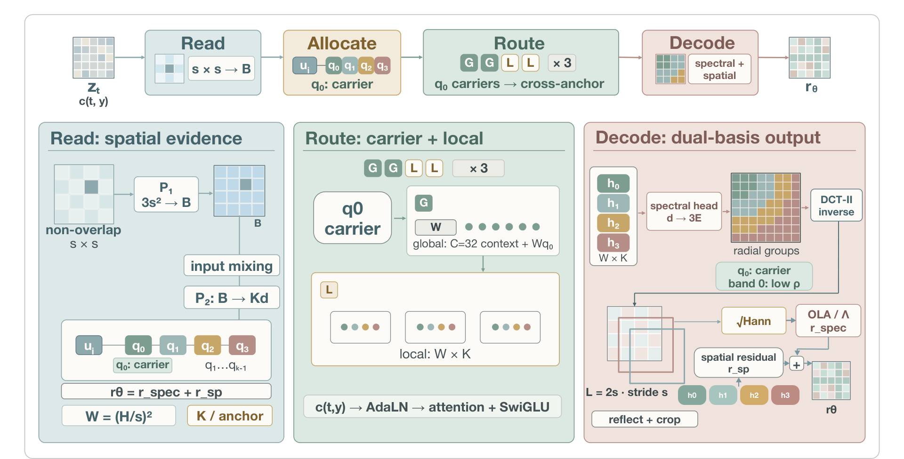

# SpecSlot

<p align="center"><strong>Read, Allocate, Route: Role-Coupled Tokenization for Pixel-Space Generative Transformers</strong></p>

<p align="center">
  <a href="https://yangjiongfan.site">Jiongfan Yang</a><sup>1,3</sup> ·
  <a href="https://weichenfan.github.io/Weichen/">Weichen Fan</a><sup>2,3</sup> ·
  <a href="https://paranioar.github.io/">Haiwen Diao</a><sup>2</sup> ·
  <a href="https://caizhongang.com/">Zhongang Cai</a><sup>3</sup> ·
  <a href="https://liuziwei7.github.io/">Ziwei Liu</a><sup>2</sup>
</p>
<p align="center"><sup>1</sup>Peking University · <sup>2</sup>Nanyang Technological University · <sup>3</sup>SenseTime</p>

<p align="center">
  <a href="https://github.com/JiongfanYang/SpecSlot"></a>
  <a href="https://huggingface.co/Gokottaw434/SpecSlot"></a>
  
  <a href="LICENSE"></a>
</p>

<p align="center">
  
</p>
<p align="center"><em>SpecSlot separates spatial anchor density from spectral subdivision. Each anchor owns K radial DCT slots; the lowest-frequency slot is the carrier for global communication, while all slots interact locally.</em></p>

## Overview

SpecSlot is a pixel-space rectified-flow Transformer that decouples output
detail from the length of the global attention sequence. A lapped-DCT tokenizer
expands each spatial anchor into fixed radial frequency slots. GGLL routing sends
only the carrier slot from each anchor through the global path and processes the
remaining slots locally. The decoder combines the spectral prediction with a
local spatial correction, while the state, target, and loss remain in pixel
space.

The released code contains the final SpecSlot ImageNet configurations and the
256px text-to-image protocol reported in the paper. It also includes vanilla
JiT B/8 and B/16 at 256px, and JiT B/16 and B/32 at 512px. The T2I protocol
uses a frozen OpenCLIP ViT-L/14 encoder and a trainable 32-query text adapter;
SpecSlot and JiT use the same text-conditioning interface.

## Results

ImageNet results are five-seed means using EMA1 weights, 50K generated images
per seed, and 50-step Heun sampling. GFLOPs are conditional forward costs
measured on one NVIDIA H800 with BF16 whole-network TorchInductor; `img/s` is
the measured Heun-50 throughput. CFG is shown for reproducibility.

### ImageNet-256

| Model | CFG | FID ↓ | IS ↑ | GFLOPs ↓ | img/s ↑ |
| --- | ---: | ---: | ---: | ---: | ---: |
| JiT-B/16 | 2.90 | 7.51 | 174.81 | 50.45 | 33.08 |
| SpecSlot W256/K2/B512 | 5.00 | 7.27 | 219.49 | 82.63 | 21.32 |
| SpecSlot W256/K4/B1536 | 4.00 | 6.59 | 215.20 | 129.20 | 9.06 |
| JiT-B/8 | 2.90 | **4.34** | **225.72** | 218.50 | 8.15 |

### ImageNet-512

| Model | CFG | FID ↓ | IS ↑ | GFLOPs ↓ | img/s ↑ |
| --- | ---: | ---: | ---: | ---: | ---: |
| JiT-B/32 | 2.90 | 15.88 | 162.12 | 51.50 | 30.61 |
| SpecSlot W256/K2/B3072 | 10.50 | 10.94 | 183.69 | 94.52 | 18.32 |
| SpecSlot W256/K4/B4096 | 8.25 | 9.14 | **208.24** | 135.64 | 12.69 |
| JiT-B/16 | 2.90 | **8.45** | 196.61 | 219.56 | 7.93 |

At 512px, SpecSlot W256/K4 reaches 9.14 FID at 135.64 GFLOPs, within 0.69
FID of JiT-B/16 at 38.2% lower forward cost. At 256px, W256/K4 provides a
lower-cost quality point between JiT-B/16 and JiT-B/8.

### Text-to-image at 256px

The T2I runs use 400,000 updates, the BLIP3o JourneyDB/Long-Caption/
Short-Caption mixture, and the official GenEval and DPG-Bench protocols.
Scores are percentages; forward GFLOPs include the trainable text adapter.

| Model | CFG | GFLOPs ↓ | DPG-Bench ↑ | GenEval ↑ |
| --- | ---: | ---: | ---: | ---: |
| JiT-B/16 | 2.90 | 50.71 | 59.22 | 24.89 |
| SpecSlot W256/K4/B1536 | 4.00 | 128.86 | **62.21** | 26.99 |
| JiT-B/8 | 2.90 | 218.77 | 61.15 | **29.78** |

<p align="center">
  
</p>
<p align="center"><em>Text-to-image samples generated by SpecSlot W256/K4 from the evaluation prompts.</em></p>

## Installation

The repository uses one Python 3.10 environment for ImageNet training,
text-to-image training, FID/IS, GenEval, and DPG-Bench. Linux and a CUDA 12.x
toolkit are required for the pinned PyTorch and MMCV builds.

```bash
conda create -n specslot python=3.10 -y
conda activate specslot
python -m pip install "uv==0.12.21"
uv sync --locked --extra eval
source .venv/bin/activate
```

Use `uv sync --locked` when only training is needed. The `eval` extra builds
the evaluator dependencies, including MMCV CUDA operators. The lockfile pins
the core versions, including PyTorch 2.5.1, CUDA 12.4 wheels, OpenCLIP, MMCV,
and MMDetection.

## ImageNet

Prepare the standard ImageFolder layout:

```text
/path/to/your/ImageNet/
├── train/<class>/*.JPEG
└── val/<class>/*.JPEG
```

The launchers train on eight GPUs with the paper's 120-epoch recipe, EMA1,
50-step Heun sampling, and checkpoint resume through `checkpoint-last.pth`.

```bash
# SpecSlot: 256px W256/K4/B1536
bash scripts/run_specslot.sh \
  /path/to/your/ImageNet /path/to/your/outputs 256 k4

# SpecSlot: 512px W256/K4/B4096
bash scripts/run_specslot.sh \
  /path/to/your/ImageNet /path/to/your/outputs 512 k4

# JiT baselines; use b8/b16 at 256px and b16/b32 at 512px
bash scripts/run_jit.sh \
  /path/to/your/ImageNet /path/to/your/outputs 256 b8
bash scripts/run_jit.sh \
  /path/to/your/ImageNet /path/to/your/outputs 256 b16
bash scripts/run_jit.sh \
  /path/to/your/ImageNet /path/to/your/outputs 512 b16
bash scripts/run_jit.sh \
  /path/to/your/ImageNet /path/to/your/outputs 512 b32
```

Use `k2` instead of `k4` in `run_specslot.sh` to launch the lower-cost
SpecSlot contract at the same resolution.

The four supported SpecSlot contracts are:

| Resolution | Allocation | Window / stride | Slots | Bottleneck | CFG | Batch/GPU |
| --- | --- | ---: | ---: | ---: | ---: | ---: |
| 256 | K2 | 32 / 16 | 512 | 512 | 5.00 | 64 |
| 256 | K4 | 32 / 16 | 1,024 | 1,536 | 4.00 | 64 |
| 512 | K2 | 64 / 32 | 512 | 3,072 | 10.50 | 128 |
| 512 | K4 | 64 / 32 | 1,024 | 4,096 | 8.25 | 128 |

The release launcher fixes these geometry/CFG pairs to make the reported
experiments reproducible. CFG sweeps require the research code or an explicit
change to the release contract.

## Text-to-image

Prepare the BLIP3o WebDataset mixture as tar shards under one directory:

```text
/path/to/your/T2I/**/*.tar
```

The default protocol is 256px, 400 epochs × 1,000 steps, batch size 64 per GPU,
learning rate `2e-4`, frozen OpenCLIP ViT-L/14 text states, a 32-query adapter,
caption dropout 0.1, and 50-step Heun sampling. The launcher defaults to
SpecSlot CFG 4.0, JiT CFG 2.9, and SpecSlot bottleneck 1,536.

```bash
# SpecSlot W256/K4/B1536
bash scripts/run_t2i_8gpu.sh \
  /path/to/your/T2I /path/to/your/t2i_runs/specslot-256 \
  specslot 256 64

# JiT-B/8
JIT_VARIANT=b8 bash scripts/run_t2i_8gpu.sh \
  /path/to/your/T2I /path/to/your/t2i_runs/jit-b8-256 \
  jit 256 64

# JiT-B/16
JIT_VARIANT=b16 bash scripts/run_t2i_8gpu.sh \
  /path/to/your/T2I /path/to/your/t2i_runs/jit-b16-256 \
  jit 256 64
```

To evaluate during training, provide the official benchmark assets and set:

```bash
EVAL_INTERVAL=10 \
EVAL_ASSETS_DIR=/path/to/your/data/Eval \
EVAL_MAX_IMAGES=0 EVAL_DPG_MAX_PROMPTS=0 \
EVAL_NUM_SAMPLES=4 EVAL_DPG_SAMPLES=4 \
REQUIRE_EVAL_METRICS=1 \
bash scripts/run_t2i_8gpu.sh \
  /path/to/your/T2I /path/to/your/t2i_runs/specslot-256-eval \
  specslot 256 64
```

`EVAL_MAX_IMAGES=0` and `EVAL_DPG_MAX_PROMPTS=0` keep the complete official
manifests. Evaluation writes generated images, raw evaluator outputs,
`metrics.json`, and TensorBoard scalars under the run directory. The release
does not bundle training shards or benchmark assets; prepare them separately.
The evaluation directory should contain the GenEval prompts and evaluator
weights, the DPG-Bench prompt file and evaluator, and (for FID/KID) an ImageNet
reference directory. Set `EVAL_ASSETS_DIR` to that directory; the launcher's
defaults use the official full prompt manifests rather than a smoke-test
subset.

## Checkpoints

Pretrained checkpoints are available in the
[SpecSlot Hugging Face repository](https://huggingface.co/Gokottaw434/SpecSlot):

- [T2I model](https://huggingface.co/Gokottaw434/SpecSlot/tree/main/T2I_model)
- [ImageNet W256/K4](https://huggingface.co/Gokottaw434/SpecSlot/tree/main/ImageNet_model/SpecSlotK4W256)
- [ImageNet W256/K2](https://huggingface.co/Gokottaw434/SpecSlot/tree/main/ImageNet_model/SpecSlotK2W256)

## Acknowledgements

We thank the authors of [Spectral Forcing](https://github.com/WeichenFan/Spectral_Forcing)
for releasing the codebase that helped establish the pixel-space spectral
generation setting used in this work. We also thank the JiT authors for the
vanilla pixel-space Transformer baseline.

## Citation

```bibtex
@article{yang2026specslot,
  title   = {Read, Allocate, Route: Role-Coupled Tokenization for Pixel-Space Generative Transformers},
  author  = {Yang, Jiongfan and Fan, Weichen and Diao, Haiwen and Cai, Zhongang and Liu, Ziwei},
  year    = {2026}
}
```

## License

This project is released under the [MIT License](LICENSE).
